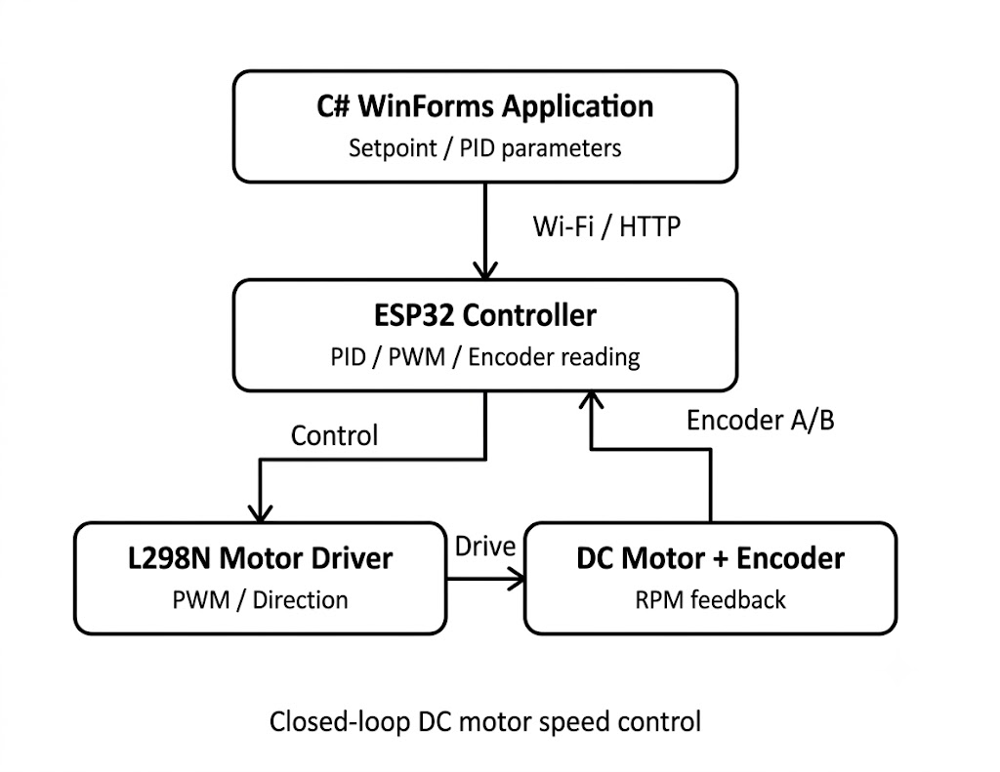
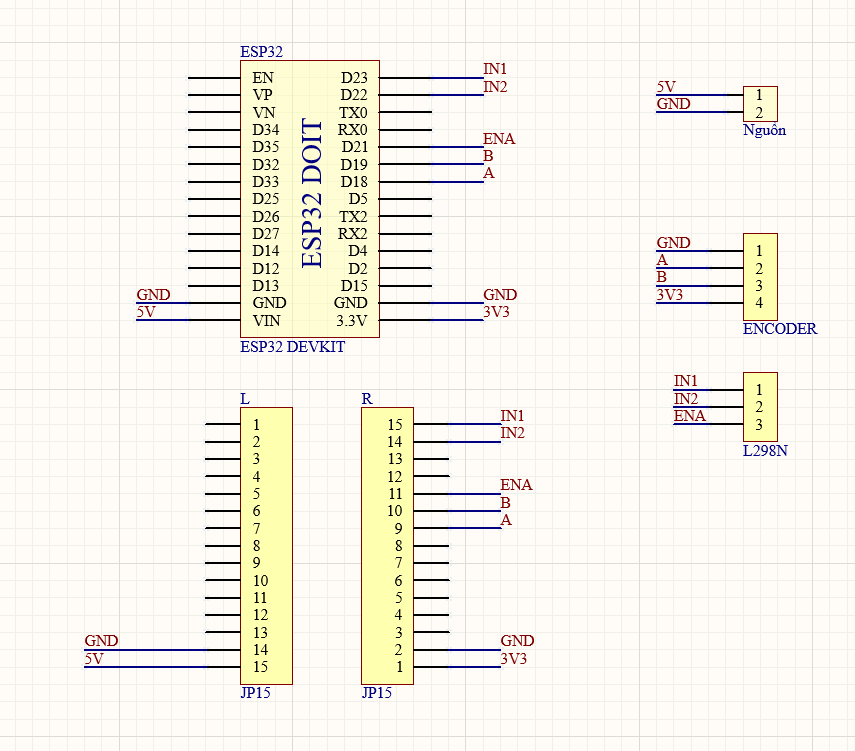
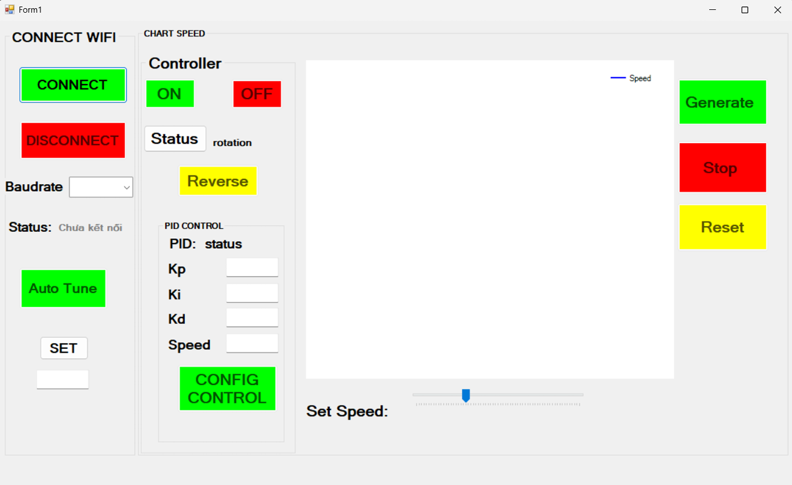

# ESP32-Based DC Motor Control and Monitoring System

**Embedded Systems · Feedback Control · PCB Design · ESP-IDF · C# WinForms**

An academic **team project (4 members)** developed for the *Computer-Based Measurement and Control* course at Ho Chi Minh City University of Technology (HCMUT), Vietnam, in 2026.

This prototype integrates an ESP32 controller, an encoder-equipped DC motor, an L298N motor driver, and a C# Windows Forms desktop application. It demonstrates closed-loop motor speed control with PID and encoder feedback, PWM-based actuation, and monitoring/control communication over Wi-Fi using HTTP.

> **My role:** Circuit schematic and PCB design using Altium Designer, and preparation of technical documentation. The complete system was developed as a team project.

## 1. System Architecture

<p align="center">
  
</p>
<p align="center"><em>Figure 1. System architecture of the ESP32 motor control prototype.</em></p>

The desktop application provides operator inputs such as speed setpoints and PID parameters. The ESP32 processes these inputs, reads encoder feedback, and drives the motor through the L298N using PWM and direction signals. Encoder feedback closes the speed-control loop.

## 2. Main Features

- ESP32-based closed-loop DC motor speed control using encoder feedback and PID.
- PWM and direction control through an L298N motor driver.
- Wi-Fi/HTTP communication between the ESP32 and a C# Windows Forms application.
- Desktop interface for motor control and monitoring.
- Circuit schematic and PCB layout designed using Altium Designer.

**Implementation note:** The documented prototype uses manually adjusted PID parameters. Automatic PID tuning should not be considered a completed feature of this version.

## 3. Hardware Design

### Circuit schematic



*Figure 2. Circuit schematic.*

### PCB visualization


*Figure 3. PCB visualization from the Altium design. This image does not by itself demonstrate a fabricated physical PCB.*

Editable Altium project files are provided in [`hardware/altium/`](hardware/altium/).

## 4. Firmware and Desktop Application

### ESP32 firmware

The ESP32 firmware is written in **C using ESP-IDF**. It handles motor-control logic, encoder feedback, PWM output, and communication with the desktop interface.

Source: [`firmware/esp32-idf/`](firmware/esp32-idf/)

### C# Windows Forms interface

The desktop application provides a user interface for motor operation and monitoring through the project's Wi-Fi/HTTP connection.



*Figure 4. Windows Forms control and monitoring interface.*

Source: [`software/csharp-winforms/`](software/csharp-winforms/)

## 5. Technologies

| Category | Tools / Components |
| --- | --- |
| Microcontroller | ESP32 |
| Firmware | C, ESP-IDF |
| Motor control | PID, PWM, encoder feedback |
| Motor driver | L298N |
| Communication | Wi-Fi, HTTP |
| Desktop application | C#, Windows Forms |
| Schematic and PCB design | Altium Designer |

## 6. Repository Structure

```text
esp32-dc-motor-pid-control/
├── README.md
├── hardware/
│   └── altium/              # Schematic, PCB, and Altium project
├── firmware/
│   └── esp32-idf/           # ESP32 firmware source and configuration
├── software/
│   └── csharp-winforms/     # Visual Studio solution and C# source
└── images/
    ├── system-architecture.jpg
    ├── Schematic.png
    ├── PCB Visualization.png
    └── Winform.png
```

*The original course report is intentionally not included in this repository.*

## 7. My Contributions

As a member of the four-person project team, I contributed primarily to:

- Designing the **circuit schematic** using Altium Designer.
- Developing the **PCB layout** and preparing the PCB design visualization.
- Preparing and consolidating **technical documentation** for the project.
- Participating in the team's system integration and project review activities.

The ESP32 firmware, PID-control implementation, communication features, and C# desktop application represent the broader team's work; this repository is not presented as a solo implementation.

## 8. Opening the Project

1. **Hardware:** Open the Altium project under `hardware/altium/` and verify that the schematic and PCB documents referenced by the project are present.
2. **Firmware:** Open `firmware/esp32-idf/` with a compatible ESP-IDF installation. Review local network settings and hardware pin assignments before building or flashing.
3. **Desktop software:** Open the Visual Studio solution under `software/csharp-winforms/` and configure the ESP32 endpoint for the local network.

Running the complete prototype requires compatible physical hardware and the appropriate local software environment. The repository is intended as a source-code and design portfolio rather than a one-click executable demo.

## 9. Limitations and Future Work

- Educational prototype; not validated as a production-ready motor controller.
- PID parameters were adjusted manually in the documented version; automatic tuning remains a potential enhancement.
- Further work could include expanded fault handling, motor protection, and network-loss recovery.

---

*Academic team project · HCMUT · 2026*
